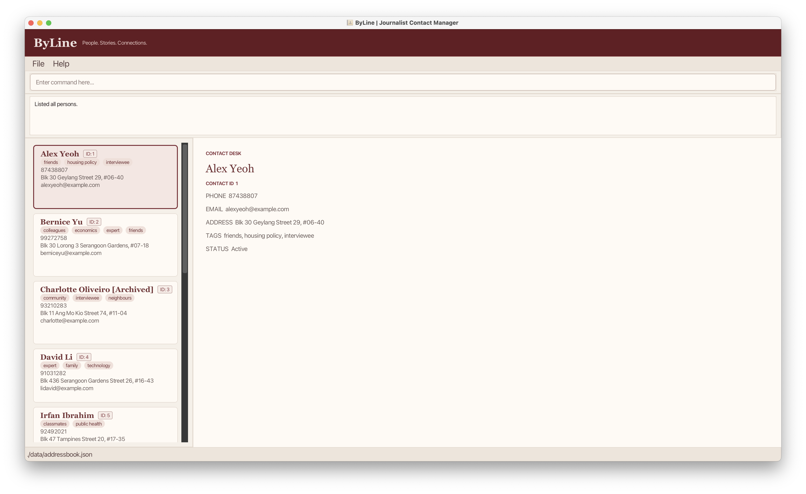

# ByLine

**ByLine** is a desktop contact manager for journalists. It helps journalists identify relevant contacts and keep track of interviewees for their reporting work.

## About ByLine

Journalists work with a large and constantly growing network of sources, experts and interviewees, often across several stories at once. These contacts usually end up scattered across notebooks, message threads and phone records, making it hard to find the right person when a story breaks.

ByLine brings all of these contacts into one place. Journalists can record each contact's details, categorise them with tags (for example by expertise), and quickly search through their contact list to find people they might need. ByLine is optimised for users who type fast and prefer typing over other means of input.

## Target Users

ByLine is designed for **journalists who manage numerous professional contacts** with varying relationship strengths and areas of expertise, and who:

* juggle multiple stories at the same time
* need to quickly find the right source or interviewee for a story
* prefer typing commands over clicking through menus

**Example user:** Kimberly is an experienced journalist working on several stories at once. Her contacts are spread across scattered notes, messages and phone records, and she needs a single place to organise them and find the right person quickly.

## Main Features

* **Add a contact**: Record a contact's name, phone number, email and address, with optional tags. 
  e.g. `add n/Jane Tan p/91234567 e/jane@example.com a/12 Kent Ridge Road t/economist`
* **Edit a contact**: Change any of a contact's details, using the ID shown on its card. 
  e.g. `edit 2 p/98765432`
* **Delete a contact**: Remove a contact using the ID shown on its card. 
  e.g. `delete 2`
* **List contacts**: Show your active contacts, only archived contacts, or every contact. 
  e.g. `list`, `list archive` or `list all`
* **Tag and untag contacts**: Add or remove tags without retyping the contact's other tags. 
  e.g. `tag 1 t/politics t/source`, then `untag 1 t/source`
* **Search contacts**: Find contacts using part of a contact’s name, phone number, email, address or tags. 
  e.g. `find n/Tan t/econ` finds contacts with `Tan` in their name and a tag containing `econ`, such as `economics`
* **Filter contacts by tag**: Show only contacts that have every tag you name. Tags must match in full. 
  e.g. `filter t/housing policy t/expert`
* **Sort contacts**: Order the contacts shown by name, phone, email, address or tag. 
  e.g. `sort name desc`
* **Archive and restore contacts**: Hide contacts you are no longer working with, without deleting them, and bring them back later. 
  e.g. `archive 4`, then `restore 4`
* **Undo and redo**: Reverse your last change, or redo a change you undid. 
  e.g. `undo`, `redo`
* **Back up and load contacts**: Save all your contacts to a file and load them back later. 
  e.g. `export C:/backups/october`, then `load C:/backups/october`

See the [User Guide](https://ay2627s1-cs2103-f13-1.github.io/tp/UserGuide.html) for every command, and the [Developer Guide](https://ay2627s1-cs2103-f13-1.github.io/tp/DeveloperGuide.html) for how ByLine is built.

## Acknowledgement of AB3

This project is based on the AddressBook-Level3 project created by the [SE-EDU initiative](https://se-education.org).
