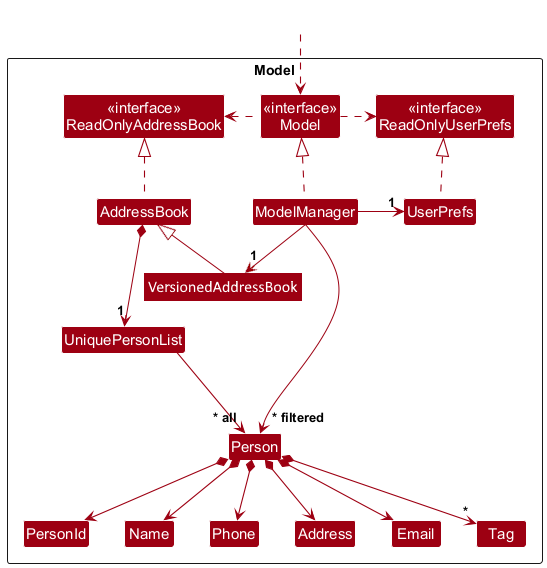
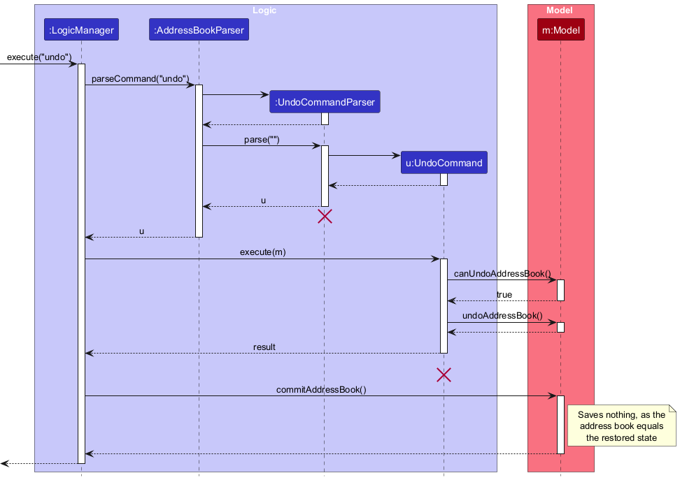
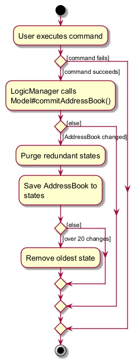

* Table of Contents
{:toc}

--------------------------------------------------------------------------------------------------------------------

## **Acknowledgements**

* _{List the sources of reused or adapted ideas, code, documentation, and third-party libraries here, with links to the originals.}_

--------------------------------------------------------------------------------------------------------------------

## **Setting up, getting started**

Refer to the guide [_Setting up and getting started_](SettingUp.md).

--------------------------------------------------------------------------------------------------------------------

## **Design**

:bulb: **Tip:** The `.puml` files used to create diagrams are in `docs/diagrams`. Refer to the [_PlantUML Tutorial_ at se-edu/guides](https://se-education.org/guides/tutorials/plantUml.html) to learn how to create and edit diagrams.

### Architecture

The ***Architecture Diagram*** given above explains the high-level design of the App.

The following provides a quick overview of the main components and their interactions.

**Main components of the architecture**

**`Main`** (consisting of classes [`Main`](https://github.com/se-edu/addressbook-level3/tree/master/src/main/java/seedu/address/Main.java) and [`MainApp`](https://github.com/se-edu/addressbook-level3/tree/master/src/main/java/seedu/address/MainApp.java)) is in charge of the app launch and shut down.
* At app launch, it initializes the other components in the correct sequence, and connects them up with each other.
* At shut down, it shuts down the other components and invokes cleanup methods where necessary.

The bulk of the app's work is done by the following four components:

* [**`UI`**](#ui-component): The UI of the App.
* [**`Logic`**](#logic-component): The command executor.
* [**`Model`**](#model-component): Holds the data of the App in memory.
* [**`Storage`**](#storage-component): Reads data from, and writes data to, the hard disk.

[**`Commons`**](#common-classes) represents a collection of classes used by multiple other components.

**How the architecture components interact with each other**

The *Sequence Diagram* below shows how the components interact with each other for the scenario where the user issues the command `delete 1`.

Each of the four main components (also shown in the diagram above),

* defines its *API* in an `interface` with the same name as the Component.
* provides its functionality through a concrete `{Component Name}Manager` class that implements the corresponding API interface.

For example, the `Logic` component defines its API in `Logic.java` and implements it in `LogicManager.java`. Other components interact with a component through its interface rather than its concrete class, preventing them from coupling to that component's implementation, as illustrated in the following partial class diagram.

The sections below give more details of each component.

### UI component

The **API** of this component is specified in [`Ui.java`](https://github.com/se-edu/addressbook-level3/tree/master/src/main/java/seedu/address/ui/Ui.java)

The UI consists of a `MainWindow` and its parts, such as `CommandBox`, `ResultDisplay`, `PersonListPanel`, and `StatusBarFooter`. All of these, including `MainWindow`, inherit from the abstract `UiPart` class, which captures common behavior among classes that represent visible GUI parts.

The `UI` component uses the JavaFX UI framework. The layouts of these UI parts are defined in matching `.fxml` files in `src/main/resources/view`. For example, [`MainWindow.fxml`](https://github.com/se-edu/addressbook-level3/tree/master/src/main/resources/view/MainWindow.fxml) specifies the layout of [`MainWindow`](https://github.com/se-edu/addressbook-level3/tree/master/src/main/java/seedu/address/ui/MainWindow.java).

The `UI` component,

* executes user commands using the `Logic` component.
* listens for changes to `Model` data so that the UI can be updated with the modified data.
* keeps a reference to the `Logic` component, because the `UI` relies on the `Logic` to execute commands.
* depends on some classes in the `Model` component because it displays `Person` objects from the model.

### Logic component

**API** : [`Logic.java`](https://github.com/se-edu/addressbook-level3/tree/master/src/main/java/seedu/address/logic/Logic.java)

Here's a (partial) class diagram of the `Logic` component:

The sequence diagram below illustrates the interactions within the `Logic` component, taking `execute("delete 1")` API call as an example.

:information_source: **Note:** The lifeline for `DeleteCommandParser` should end at the destroy marker (X), but due to a limitation of PlantUML, it continues to the end of the diagram.

How the `Logic` component works:

1. When `Logic` is called upon to execute a command, the command is passed to an `AddressBookParser` object, which in turn creates a parser that matches the command (e.g., `DeleteCommandParser`) and uses it to parse the command.
1. This results in a `Command` object (more precisely, an object of one of its subclasses e.g., `DeleteCommand`) which is executed by the `LogicManager`.
1. The command can communicate with the `Model` when it is executed (e.g. to delete a person). 
   Note that although this is shown as a single step in the diagram above for simplicity, the code can require several interactions between the command object and the `Model` to complete the operation.
1. The result of the command execution is encapsulated as a `CommandResult` object which is returned from `Logic`.

Here are the other classes in `Logic` (omitted from the class diagram above) that are used for parsing a user command:

How the parsing works:
* When called upon to parse a user command, the `AddressBookParser` class creates an `XYZCommandParser` (`XYZ` is a placeholder for the specific command name, e.g., `AddCommandParser`). The parser uses the other classes shown above to parse the user command and create an `XYZCommand` object (e.g., `AddCommand`). The `AddressBookParser` returns that object as a `Command` object.
* All `XYZCommandParser` classes, such as `AddCommandParser` and `DeleteCommandParser`, implement the `Parser` interface so they can be treated similarly where appropriate, for example during testing.

### Model component
**API** : [`Model.java`](https://github.com/se-edu/addressbook-level3/tree/master/src/main/java/seedu/address/model/Model.java)

The `Model` component,

* stores the address book data i.e., all `Person` objects (which are contained in a `UniquePersonList` object).
* gives every `Person` a `PersonId` when it is added, using a counter of the next ID to give out (see [Contact ID feature](#contact-id-feature)).
* stores the `Person` objects selected by the current filter, such as search results, in a separate _filtered_ list. It exposes this list as an unmodifiable `ObservableList<Person>` that the UI can observe and bind to, so the UI updates when the list changes.
* stores a `UserPrefs` object that represents the user’s preferences (currently, just the GUI settings). This is exposed to the outside as a `ReadOnlyUserPrefs` object.
* does not depend on any of the other three components (as the `Model` represents data entities of the domain, they should make sense on their own without depending on other components)

:information_source: **Note:** The alternative, arguably more object-oriented, design below keeps a unique list of tags in `AddressBook`, and each `Person` references tags from that list. This lets `AddressBook` maintain one `Tag` object per unique tag instead of each `Person` holding its own `Tag` objects. 

### Storage component

**API** : [`Storage.java`](https://github.com/se-edu/addressbook-level3/tree/master/src/main/java/seedu/address/storage/Storage.java)

The `Storage` component,
* can save both address book data and user preference data in JSON format, and read them back into corresponding objects.
* saves each person's ID and the next ID to give out, so that IDs stay the same after a restart and are never reused.
* is implemented by `StorageManager`, which delegates the actual JSON file access to `JsonAddressBookStorage` and `JsonUserPrefsStorage` (one class per data file).
* depends on some classes in the `Model` component (because the `Storage` component's job is to save/retrieve objects that belong to the `Model`)

### Common classes

Classes used by multiple components are in the `seedu.address.commons` package.

--------------------------------------------------------------------------------------------------------------------

## **Implementation**

This section describes some noteworthy details on how certain features are implemented.

### Contact ID feature

Every contact has a `PersonId`, a whole number from 1 to `PersonId.MAX_VALUE` (999999). Commands that act on one contact, such as `edit`, `delete`, `tag`, `untag`, `archive` and `restore`, select the contact by this ID instead of by its position in the displayed list.

#### Assigning IDs

`AddressBook` holds a counter, `nextPersonId`, starting at 1. When `AddressBook#addPerson(Person)` receives a person without an ID, it gives the person the ID `nextPersonId` and moves the counter on. A person that already has an ID keeps it, and the counter moves past that ID if needed, so a new ID is always higher than every ID in use.

The counter only moves forward. Deleting a person does not lower it, and `clear` creates the new, empty address book with the same counter, so a deleted ID is never given out again.

`EditCommand`, `TagCommand`, `UntagCommand`, `ArchiveCommand` and `RestoreCommand` replace a person with an updated copy. Each copy keeps the original's ID, and `AddressBook#setPerson` rejects a copy whose ID differs.

Once ID 999999 has been given out, the counter is 1000000 and `AddressBook#hasAvailablePersonId()` returns false. `AddCommand` checks `Model#hasAvailablePersonId()` and shows an error instead of adding the person. Because the largest ID is far below the largest `int`, the counter can never overflow and wrap around to an ID in use.

#### Selecting a contact by ID

1. The command's parser calls `ParserUtil#parsePersonTarget`, which reads the number before the first prefix, e.g. the `3` in `edit 3 p/91234567`. Anything that is not a whole number from 1 to 999999 gives the invalid command format message.
1. The parser creates the command with a `PersonTarget` for that ID.
1. When the command runs, `PersonTarget#resolve(Model)` calls `Model#findPersonById`, which searches the **whole** address book, not only the displayed list. A contact hidden by `find`, moved by `sort` or archived can therefore still be selected. If no contact has the ID, `resolve` throws a `CommandException` with `No contact has the ID 3.`

New commands that act on one contact should use `parsePersonTarget` and `PersonTarget`, so that every command reads IDs the same way.

#### Saving IDs

`JsonAdaptedPerson` saves each ID as text, e.g. `"id" : "3"`, and `JsonSerializableAddressBook` saves the counter as `"nextPersonId"`. When the file is loaded:

* The counter is raised above the highest saved ID if needed, so a hand-edited counter cannot cause an ID to be reused.
* The file is rejected as invalid if two persons have the same ID, an ID is outside 1 to 999999, or `nextPersonId` is outside 1 to 1000000.
* Persons saved without an ID (data from before IDs were added) are given new IDs, and `JsonAddressBookStorage` saves the file again straight away so that those IDs are kept.

#### Design considerations

**Aspect: How commands select a contact**

* **Alternative 1 (current choice): A persistent ID.**
  * Pros: The same number always means the same contact, whatever is displayed. A contact hidden by `find` or moved by `sort` can still be edited or deleted, and there is no risk of acting on the wrong contact after the list changes.
  * Cons: Users read the ID from the card instead of counting positions, and IDs must be saved and kept unique.
* **Alternative 2: The position in the displayed list (AB3's original design).**
  * Pros: Nothing extra needs to be stored.
  * Cons: The same number points to a different contact after `find`, `sort` or a deletion, so it is easy to edit or delete the wrong contact.

**Aspect: Whether deleted IDs are reused**

* **Alternative 1 (current choice): Never reuse IDs.**
  * Pros: An ID that a journalist has noted down never points to a different contact later.
  * Cons: IDs have gaps, and the limit of 999999 applies to every contact ever added, not just the ones currently stored.
* **Alternative 2: Reuse the lowest free ID.**
  * Pros: IDs stay small and have no gaps.
  * Cons: An old ID can suddenly mean a different contact, which is the problem persistent IDs are meant to solve.

### Tag and untag feature

`TagCommandParser` and `UntagCommandParser` read the contact's ID with `ParserUtil#parsePersonTarget` (see [Contact ID feature](#contact-id-feature)) and the tags with `ParserUtil#parseTags`. At least one `t/` prefix is required. Otherwise, the parser throws a `ParseException` with the command's usage message.

When executed, both commands find the contact with `PersonTarget#resolve` and copy its tags into a new set. `TagCommand` adds the given tags to the set, and `UntagCommand` removes them. The command then replaces the contact, through `Model#setPerson`, with a copy that has the new tags and the same ID, details and archive flag.

`Tag` saves its name in lowercase, and tags are compared by that name. A contact's tags are a `Set<Tag>`, so adding a tag the contact already has, in any upper/lower case, does not create a second copy, and removing a tag matches it regardless of case.

Unlike `edit t/…`, which replaces all of a contact's tags, `tag` and `untag` change only the tags given.

#### Design considerations

**Aspect: How tags are added and removed**

* **Alternative 1 (current choice): Separate `tag` and `untag` commands.**
  * Pros: A journalist can add or remove one tag without retyping the contact's other tags.
  * Cons: Two more commands to learn.
* **Alternative 2: Only `edit t/…`.**
  * Pros: Fewer commands.
  * Cons: Changing one tag means retyping every other tag, and leaving one out removes it by mistake.

**Aspect: Upper/lower case in tags**

* **Alternative 1 (current choice): Save tags in lowercase.**
  * Pros: `Expert` and `expert` are the same tag, so a contact cannot end up with both, and tags look consistent in the list.
  * Cons: The capitalisation the journalist typed is lost.
* **Alternative 2: Keep tags as typed.**
  * Pros: Tags look exactly as typed.
  * Cons: Every comparison would need to ignore case separately, or near-identical tags would pile up.

### Find feature

`AddressBookParser` delegates `find` arguments to `FindCommandParser`, which selects one of two search modes. Both modes match consecutive substrings case-insensitively:

* **Search across all fields:** When no recognised prefixes are present, the parser trims the input and passes it as one substring to `AnyFieldContainsSubstringPredicate`. This predicate searches `Person.toString()`, so the searchable details depend on that string representation.
* **Search by field:** When prefixes are present, the parser creates an `EachFieldContainsSubstringPredicate`. Each substring is matched only against its corresponding field, and all specified conditions must match. Adding field or tag conditions therefore narrows the results. The parser rejects text before the first prefix and duplicate non-tag prefixes.

For field searches, `ArgumentMultimap.getValue(...)` returns an `Optional<String>` for each of the name, phone, email, and address prefixes. The parser passes these objects directly into the predicate constructor. An absent prefix produces `Optional.empty()`, so the predicate skips that field; a present value is used as the field's substring. For example, `find n/Al e/example.com` supplies `Optional.of("Al")` and `Optional.of("example.com")` for name and email, with empty optionals for phone and address.

Tags use `getAllValues(PREFIX_TAG)` instead, producing a `List<String>` to support repeated `t/` prefixes. Every tag substring must match at least one of the person's tags; an empty list imposes no tag restriction.

Both predicates implement `Predicate<Person>` and are passed to `FindCommand`. On execution, the command calls `Model.updateFilteredPersonList(predicate)` and reports the number of matching persons.

### Sort feature

`AddressBookParser` delegates the arguments of a `sort` command to `SortCommandParser`. The parser validates the mandatory field and optional order, normalises both case-insensitively, defaults a missing order to ascending, and creates a `SortCommand`.

When executed, `SortCommand` selects a comparator through `PersonComparator` and asks the model to sort the displayed contacts. The model retains the stored contacts in `AddressBook`, exposes the selected subset through a `FilteredList`, and applies the comparator to a `SortedList` layered over that filtered view. This changes the order observed by the UI without reordering the persistent `AddressBook` list.

Text fields are compared case-insensitively, phone numbers numerically, and tags by their alphabetically first tag. The comparator applies name-ascending tie-breaking. `ModelManager` then preserves the prior displayed order for contacts that remain completely tied. `list` and commands that apply a new filter call `updateFilteredPersonList`, which clears the `SortedList` comparator before replacing the predicate.

#### Design considerations

**Aspect: Where sorting is applied**

* **Alternative 1 (current choice): Use a sorted view of the filtered contacts.**
  * Pros: Sorting affects exactly the contacts being displayed, composes with filtering, and cannot change the saved contact order.
  * Cons: The model must maintain both `FilteredList` and `SortedList` view layers and explicitly clear the comparator when the display is replaced.
* **Alternative 2: Sort the stored contact list directly.**
  * Pros: The UI could display the reordered storage list without another view layer.
  * Cons: A display-only command would mutate persistent ordering, filtering would be harder to isolate, and the changed order could be saved unintentionally. This alternative was rejected because sorting is specified as a temporary presentation operation.

### Archive feature

Each `Person` has an `archived` flag, which is `false` for new contacts. `ArchiveCommand` and `RestoreCommand` select the contact by ID through `PersonTarget` (see [Contact ID feature](#contact-id-feature)), then replace it with a copy whose flag is `true` or `false`. All other fields, including the ID, are copied unchanged. Archiving a contact that is already archived, or restoring one that is not, throws a `CommandException` and changes nothing.

`JsonAdaptedPerson` saves the flag as `"archived"`. Files saved before archiving existed have no such field, so their contacts load as not archived. `PersonCard` adds `[Archived]` after the name of an archived contact.

`ListCommandParser` turns `list active` and `list archived` into a `ListCommand` with the view `ACTIVE` or `ARCHIVED`. These views call `Model#updateFilteredPersonList` with `PREDICATE_SHOW_ACTIVE_PERSONS` or `PREDICATE_SHOW_ARCHIVED_PERSONS`. Plain `list` uses `PREDICATE_SHOW_ALL_PERSONS`, so it still shows archived contacts.

Other commands, such as `find`, `edit`, `tag` and `delete`, treat archived contacts like any other contact. `EditCommand`, `TagCommand` and `UntagCommand` copy the flag into the updated person, so changing a contact's details does not restore it.

#### Design considerations

**Aspect: How archived contacts are stored**

* **Alternative 1 (current choice): A flag on each `Person`, in the same list as other contacts.**
  * Pros: An archived contact keeps its ID and details, and every command that selects a contact by ID works on it unchanged.
  * Cons: Every command that creates an updated `Person` must remember to copy the flag.
* **Alternative 2: A separate list of archived contacts.**
  * Pros: Active and archived contacts are clearly separated.
  * Cons: Looking up an ID would have to search two lists, and archiving would move a contact between lists.

### \[Proposed\] Undo/redo feature

#### Proposed Implementation

The proposed undo/redo mechanism is facilitated by `VersionedAddressBook`. It extends `AddressBook` with an undo/redo history, stored internally as an `addressBookStateList` and `currentStatePointer`. Additionally, it implements the following operations:

* `VersionedAddressBook#commit()` — Saves the current address book state in its history.
* `VersionedAddressBook#undo()` — Restores the previous address book state from its history.
* `VersionedAddressBook#redo()` — Restores a previously undone address book state from its history.

These operations are exposed in the `Model` interface as `Model#commitAddressBook()`, `Model#undoAddressBook()` and `Model#redoAddressBook()` respectively.

Given below is an example usage scenario and how the undo/redo mechanism behaves at each step.

Step 1. The user launches the application for the first time. The `VersionedAddressBook` will be initialized with the initial address book state, and the `currentStatePointer` pointing to that single address book state.

Step 2. The user executes `delete 5` command to delete the contact with ID 5. The `delete` command calls `Model#commitAddressBook()`, causing the modified state of the address book after the `delete 5` command executes to be saved in the `addressBookStateList`, and the `currentStatePointer` is shifted to the newly inserted address book state.

Step 3. The user executes `add n/David …​` to add a new person. The `add` command also calls `Model#commitAddressBook()`, causing another modified address book state to be saved into the `addressBookStateList`.

:information_source: **Note:** If a command fails its execution, it will not call `Model#commitAddressBook()`, so the address book state will not be saved into the `addressBookStateList`.

Step 4. The user now decides that adding the person was a mistake, and decides to undo that action by executing the `undo` command. The `undo` command will call `Model#undoAddressBook()`, which will shift the `currentStatePointer` once to the left, pointing it to the previous address book state, and restores the address book to that state.

:information_source: **Note:** If the `currentStatePointer` is at index 0, pointing to the initial AddressBook state, then there are no previous AddressBook states to restore. The `undo` command uses `Model#canUndoAddressBook()` to check if this is the case. If so, it will return an error to the user rather
than attempting to perform the undo.

The following sequence diagram shows how an undo operation goes through the `Logic` component:

:information_source: **Note:** The lifeline for `UndoCommand` should end at the destroy marker (X), but due to a limitation of PlantUML, it continues to the end of the diagram.

Similarly, how an undo operation goes through the `Model` component is shown below:

The `redo` command does the opposite — it calls `Model#redoAddressBook()`, which shifts the `currentStatePointer` once to the right, pointing to the previously undone state, and restores the address book to that state.

:information_source: **Note:** If the `currentStatePointer` is at index `addressBookStateList.size() - 1`, pointing to the latest address book state, then there are no undone AddressBook states to restore. The `redo` command uses `Model#canRedoAddressBook()` to check if this is the case. If so, it will return an error to the user rather than attempting to perform the redo.

Step 5. The user then decides to execute the command `list`. Commands that do not modify the address book, such as `list`, will usually not call `Model#commitAddressBook()`, `Model#undoAddressBook()` or `Model#redoAddressBook()`. Thus, the `addressBookStateList` remains unchanged.

Step 6. The user executes `clear`, which calls `Model#commitAddressBook()`. Since the `currentStatePointer` is not pointing at the end of the `addressBookStateList`, all address book states after the `currentStatePointer` will be purged. Reason: It no longer makes sense to redo the `add n/David …​` command. This is the behavior that most modern desktop applications follow.

The following activity diagram summarizes what happens when a user executes a new command:

#### Design considerations:

**Aspect: How undo & redo execute:**

* **Alternative 1 (current choice):** Saves the entire address book.
  * Pros: Easy to implement.
  * Cons: May have performance issues in terms of memory usage.

* **Alternative 2:** Individual command knows how to undo/redo by
  itself.
  * Pros: Will use less memory (e.g. for `delete`, just save the person being deleted).
  * Cons: We must ensure that the implementation of each individual command is correct.

_{more aspects and alternatives to be added}_

### \[Proposed\] Data archiving

_{Explain here how the data archiving feature will be implemented}_

--------------------------------------------------------------------------------------------------------------------

## **Documentation, logging, testing, dev-ops**FF

* [Documentation guide](Documentation.md)
* [Testing guide](Testing.md)
* [Logging guide](Logging.md)
* [DevOps guide](DevOps.md)

--------------------------------------------------------------------------------------------------------------------

## **Appendix: Requirements**

### Product scope

**Target user profile**:

This product is for journalists who have many valuable contacts to keep track of. They may not have close ties with all of their contacts.

* has a need to manage a significant number of contacts
* prefers desktop apps over other types of applications
* can type fast
* prefers typing to mouse interactions
* is reasonably comfortable using CLI apps

**Value proposition**: Journalists have the problem of not knowing who in their contacts to ask for help for their stories that they are currently writing. Our app helps journalists identify relevant contacts and keep track of interviewees to contact them for follow-up.

### User stories

Priorities: High (must have) - `* * *`, Medium (nice to have) - `* *`, Low (unlikely to have) - `*`

| Priority | As a …​ | I want to …​ | So that I can…​ |
| -------- | -------- | ------------ | ---------------- |
| `* * *` | new user | see usage instructions | refer to instructions when I forget how to use ByLine |
| `* * *` | journalist | add a new contact | keep track of people who may be useful for my reporting |
| `* * *` | journalist | list my contacts | see the contacts I have saved |
| `* * *` | journalist | delete a contact | remove contacts that I no longer need |
| `* * *` | journalist | refer to a contact by a fixed ID | act on the right contact even after searching or sorting the list |
| `* * *` | journalist | search for contacts by their details | quickly locate relevant contacts without going through the entire list |
| `* * *` | journalist | assign tags to contacts | organise contacts based on information relevant to my work |
| `* * *` | journalist | filter contacts by tag | quickly identify contacts relevant to a particular topic or need |
| `* * *` | journalist | sort the displayed contacts by a selected field and order | review a large result list in a useful sequence without changing stored data |
| `* *` | journalist | edit a contact's details | keep my contact information accurate and up to date |
| `* *` | journalist | assign multiple tags to a contact | categorise the same contact in multiple useful ways |
| `* *` | journalist | remove tags from a contact | keep a contact's tags accurate when their role or relevance changes |
| `* *` | journalist | archive a contact I am no longer working with | keep my active contacts short without losing anyone's details |
| `* *` | journalist | restore an archived contact | work with that contact again |
| `* *` | journalist | view only my active or only my archived contacts | focus on the contacts I need right now |

### Use cases

**System:** Byline 
**Use case:** UC01 - Delete a person 
**Actor:** Journalist

**MSS**

1.  Journalist requests to list persons
2.  Byline shows a list of persons
3.  Journalist requests to delete a specific person by its ID
4.  Byline deletes the person

    Use case ends.

**Extensions**

* 2a. The list is empty.

  Use case ends.

* 3a. The given ID is not a whole number from 1 to 999999.

    * 3a1. Byline shows an error message stating the correct format.

      Use case resumes at step 2.

* 3b. No person has the given ID.

    * 3b1. Byline shows an error message stating that no contact has that ID.

      Use case resumes at step 2.

**System:** Byline 
**Use case:** UC02 - Add a contact 
**Actor:** Journalist

**MSS**

1.  Journalist requests to add a contact, providing the contact's name, phone number, email, and optionally an address and tags
2.  Byline adds the contact and shows the details of the added contact

    Use case ends.

**Extensions**

* 1a. A compulsory detail (name, phone number or email) is missing.

    * 1a1. Byline shows an error message stating the correct format.

      Use case resumes at step 1.

* 1b. One or more of the given details is invalid (e.g. the phone number contains non-digit characters).

    * 1b1. Byline shows an error message describing the valid format of that detail.

      Use case resumes at step 1.

* 1c. No address is given.

    * 1c1. Byline records the address as "NA" and shows a warning that no address was given.

      Use case resumes at step 2.

**Guarantees**

* The contact is added only if all given details are valid.

**System:** Byline 
**Use case:** UC03 - List all contacts 
**Actor:** Journalist

**MSS**

1.  Journalist requests to list all contacts
2.  Byline shows the list of all contacts

    Use case ends.

**Extensions**

* 2a. There are no contacts.

    * 2a1. Byline shows a message that there are no contacts.

      Use case ends.

**System:** Byline 
**Use case:** UC04 - Tag a contact 
**Actor:** Journalist

**MSS**

1.  Journalist requests to list contacts
2.  Byline shows a list of contacts
3.  Journalist requests to add one or more tags to a specific contact by its ID
4.  Byline adds the tags to the contact and shows the updated contact

    Use case ends.

**Extensions**

* 2a. The list is empty.

  Use case ends.

* 3a. The given ID is not valid, or no contact has that ID.

    * 3a1. Byline shows an error message.

      Use case resumes at step 2.

* 3b. A given tag contains characters other than letters, numbers and spaces.

    * 3b1. Byline shows an error message stating that tags can contain only letters, numbers and spaces.

      Use case resumes at step 2.

* 3c. The contact already has one of the given tags (ignoring upper/lower case).

    * 3c1. Byline keeps the existing tag and adds the remaining tags.

      Use case resumes at step 4.

* 3d. No tag is given.

    * 3d1. Byline shows an error message stating the correct format.

      Use case resumes at step 2.

**Guarantees**

* A contact never has two tags that differ only in upper/lower case.

**System:** Byline 
**Use case:** UC05 - Search for contacts 
**Actor:** Journalist

**MSS**

1.  Journalist requests to search for contacts, giving one or more search criteria (name, phone number, email, address and/or tag)
2.  Byline shows the contacts that match all the given criteria

    Use case ends.

**Extensions**

* 1a. No search criteria are given.

    * 1a1. Byline shows an error message stating the correct format.

      Use case resumes at step 1.

* 2a. No contacts match all the given criteria.

    * 2a1. Byline shows an empty list and a message that no contacts were found.

      Use case ends.

*{More to be added}*

**System:** Byline 
**Use case:** UC06 - Sort displayed contacts 
**Actor:** Journalist

**MSS**

1. Journalist views a list of contacts.
2. Journalist requests to sort the displayed contacts, specifying a supported field and optionally an order.
3. Byline reorders the displayed contacts and shows the successful sort message.

   Use case ends.

**Extensions**

* 2a. The field is invalid.
  * 2a1. Byline shows `Invalid sort field. Valid fields are name, phone, email, address, and tag.`
  * 2a2. The displayed list remains unchanged.

    Use case resumes at step 1.

* 2b. The order is invalid.
  * 2b1. Byline shows `Invalid sort order. ORDER must be asc or desc.`
  * 2b2. The displayed list remains unchanged.

    Use case resumes at step 1.

* 2c. The field is missing.
  * 2c1. Byline shows the invalid command format message and `Usage: sort FIELD [ORDER]`.
  * 2c2. The displayed list remains unchanged.

    Use case resumes at step 1.

* 2d. Extra arguments are supplied.
  * 2d1. Byline shows the invalid command format message and `Usage: sort FIELD [ORDER]`.
  * 2d2. The displayed list remains unchanged.

    Use case resumes at step 1.

**System:** Byline 
**Use case:** UC07 - Archive a contact 
**Actor:** Journalist

**MSS**

1.  Journalist requests to list contacts
2.  Byline shows a list of contacts
3.  Journalist requests to archive a specific contact by its ID
4.  Byline marks the contact as archived and shows the archived contact

    Use case ends.

**Extensions**

* 3a. The given ID is not valid, or no contact has that ID.

    * 3a1. Byline shows an error message.

      Use case resumes at step 2.

* 3b. The contact is already archived.

    * 3b1. Byline shows an error message stating that the contact is already archived.

      Use case resumes at step 2.

**Guarantees**

* The contact's details and ID are unchanged.

**System:** Byline 
**Use case:** UC08 - Restore an archived contact 
**Actor:** Journalist

**MSS**

1.  Journalist requests to list archived contacts
2.  Byline shows the archived contacts
3.  Journalist requests to restore a specific contact by its ID
4.  Byline marks the contact as no longer archived and shows the restored contact

    Use case ends.

**Extensions**

* 2a. There are no archived contacts.

  Use case ends.

* 3a. The given ID is not valid, or no contact has that ID.

    * 3a1. Byline shows an error message.

      Use case resumes at step 2.

* 3b. The contact is not archived.

    * 3b1. Byline shows an error message stating that the contact is not archived.

      Use case resumes at step 2.

**Guarantees**

* The contact's details and ID are unchanged.

**System:** Byline 
**Use case:** UC09 - Remove tags from a contact 
**Actor:** Journalist

**MSS**

1.  Journalist requests to list contacts
2.  Byline shows a list of contacts
3.  Journalist requests to remove one or more tags from a specific contact by its ID
4.  Byline removes the tags from the contact and shows the updated contact

    Use case ends.

**Extensions**

* 2a. The list is empty.

  Use case ends.

* 3a. The given ID is not valid, or no contact has that ID.

    * 3a1. Byline shows an error message.

      Use case resumes at step 2.

* 3b. No tag is given.

    * 3b1. Byline shows an error message stating the correct format.

      Use case resumes at step 2.

* 3c. A given tag contains characters other than letters, numbers and spaces.

    * 3c1. Byline shows an error message stating that tags can contain only letters, numbers and spaces.

      Use case resumes at step 2.

**Guarantees**

* The contact's other tags and details are unchanged.

### Non-Functional Requirements

These requirements define the quality targets and operating constraints for ByLine.

1. **Keyboard usability:** After launch, journalists should be able to add, list, edit, delete, tag,
   and search contacts using only the keyboard.
2. **Error guidance:** Invalid command syntax or contact details should produce a visible error
   message explaining the accepted command format or the relevant field constraint.
3. **Capacity and performance:** ByLine should support 1,000 contacts. With that dataset, adding,
   listing, editing, deleting, tagging, and searching contacts should each display a result within
   one second on a machine with at least a dual-core 2 GHz processor, 8 GB RAM, local SSD storage,
   and Java 25, with no other resource-intensive applications running. This target applies to
   contact records of at most 1 KB each and excludes application startup.
4. **Platform compatibility:** ByLine should run as a desktop application on Windows, macOS,
   and Linux with a compatible Java 25 runtime, without requiring an IDE.
5. **Offline operation:** After installation, managing contacts and saving or loading contact data
   should work without an internet connection or an external database service.
6. **Persistent local storage:** Contact data should be stored locally in JSON format. When the
   configured data location is writable, each successfully completed command that changes contacts
   should save the updated data without a separate save action. Restarting ByLine should restore
   the saved contact details and tags.
7. **Input reliability:** A command rejected because of invalid syntax, invalid field values, or
   an invalid or unknown contact ID should leave existing contact records unchanged and allow the user
   to enter another command without restarting ByLine.
8. **Storage failure reporting:** If saving contact data fails, ByLine should show a visible error
   indicating that the save failed, rather than reporting the command as successfully completed.

### Glossary

The terms below are used consistently throughout the requirements, design, implementation, and testing sections of this guide.

* **AB3**: AddressBook Level 3, the application on which ByLine is based. Some inherited class names and implementation details continue to use AB3 terminology.
* **Address**: The free-text field used to record a contact's address or general location.
* **Address book**: The internal collection that stores all contact records. This name is inherited from AB3 and is represented by the `AddressBook` class in the codebase.
* **AND search**: A search involving multiple criteria in which a contact must satisfy every specified criterion to be included in the results.
* **ByLine**: A desktop, CLI-based contact-management application that helps journalists organise and retrieve professional contacts relevant to their reporting. Users interact with ByLine primarily by typing commands, while a GUI displays their contacts and command results.
* **Case-insensitive matching**: Comparing text without treating uppercase and lowercase letters as different. For example, `Housing` and `housing` are considered equivalent.
* **CLI (Command Line Interface)**: A text-based interface through which users operate ByLine by typing commands.
* **Command**: A text instruction entered through the CLI to perform an operation, such as adding, listing, deleting, tagging, or searching for contacts.
* **Command prefix**: A marker that identifies the meaning of a command parameter, such as `n/` for a name or `t/` for a tag.
* **Complete contact list**: All contacts stored in ByLine, regardless of the contacts currently displayed in the UI.
* **Contact**: A person whose details a journalist stores in ByLine because the person may be relevant to current or future reporting.
* **Contact ID**: The number shown as `ID: 3` on a contact's card. A contact gets the next unused ID when it is added and keeps it permanently. IDs are never reused. Commands that act on one contact select it by this ID.
* **Contact record**: The complete set of information stored about one contact, including their name, phone number, email address, address, and tags.
* **Displayed contact list**: The contacts currently visible in the UI. It may contain all stored contacts or only the contacts returned by a search.
* **Duplicate contact**: A contact whose normalised name is the same as that of an existing contact. Name comparison ignores letter case and leading, trailing, or repeated spaces.
* **Duplicate tag**: A tag that is already assigned to a contact or is repeated within the same command, ignoring letter case.
* **Exact tag match**: A match that occurs only when the complete search value is equal to a contact's complete tag, ignoring letter case.
* **Expert**: A contact with specialist knowledge relevant to a story or topic.
* **Filtered contact list**: The internal list of contacts that satisfy the current search criteria. It provides the data shown in the displayed contact list.
* **GUI (Graphical User Interface)**: The visual interface that displays the command box, contact list, command results, and other application information.
* **Interviewee**: A contact whom a journalist has interviewed or intends to interview.
* **Journalist**: The target user of ByLine, who manages professional contacts for reporting purposes and prefers a command-driven desktop application.
* **Mainstream OS**: Windows, Linux, Unix, or macOS.
* **MVP (Minimum Viable Product)**: The smallest set of features required for ByLine to provide its intended core value to journalists.
* **Normalised name**: A contact name converted to a standard form for comparison by ignoring letter case and leading, trailing, or repeated spaces.
* **Partial match**: A match that occurs when a search value appears within a stored field without being equal to the complete field value.
* **Person**: The internal model entity used to represent a contact. This term is inherited from AB3 and appears in class names such as `Person` and `UniquePersonList`; user-facing documentation should use **contact** instead.
* **Potential source**: A contact who may be able to provide information for a story but has not necessarily been approached or interviewed.
* **Private contact detail**: Contact information that is not intended to be shown or shared with others.
* **Search criterion**: A field and value used to restrict search results, such as a name, phone number, email address, address, or tag.
* **Source**: A contact who provides, or may provide, information, evidence, background, or commentary for a journalist's reporting.
* **Story**: A news article, investigation, or other reporting assignment on which a journalist is working.
* **Tag**: A journalist-defined label assigned to a contact to represent an area of expertise, topic, role, organisation, or another useful characteristic.
* **Topic**: A subject area used to describe the focus of a story or a contact's relevance, such as housing policy or public health.

--------------------------------------------------------------------------------------------------------------------

## **Appendix: Instructions for manual testing**

Given below are instructions to test the app manually.

:information_source: **Note:** These instructions only provide a starting point for testers to work on;
testers are expected to do more *exploratory* testing.

### Launch and shutdown

1. Initial launch

   1. Download the JAR file and copy it into an empty folder.

   1. Double-click the JAR file. 
      Expected: The GUI opens with a set of sample contacts. The window size may not be optimal.

1. Saving window preferences

   1. Resize the window to an optimal size. Move the window to a different location. Close the window.

   1. Relaunch the app by double-clicking the JAR file. 
       Expected: The most recent window size and location are retained.

1. _{ more test cases …​ }_

### Deleting a person

1. Deleting a person by ID

   1. Prerequisites: Multiple contacts exist. Note the ID shown on one contact's card, e.g. `ID: 2`.

   1. Test case: `delete 2` 
      Expected: The contact with ID 2 is deleted, wherever it appears in the list. The status message shows the deleted contact's details.

   1. Test case: Run `find` so that the contact with ID 3 is not shown, then enter `delete 3`. 
      Expected: The contact with ID 3 is deleted even though it was not shown.

   1. Test case: `delete 2` again 
      Expected: Nothing is deleted. The status message is `No contact has the ID 2.`

   1. Test case: `delete 0` 
      Expected: Nothing is deleted. The status message shows the invalid command format message.

   1. Other incorrect delete commands to try: `delete`, `delete x`, `delete C3`, `delete 1000000` 
      Expected: Similar to previous.

1. IDs are not reused

   1. Test case: Delete the contact with the highest ID, then add a new contact. 
      Expected: The new contact gets the next ID after the deleted one, not the deleted ID.

1. _{ more test cases …​ }_

### Sorting displayed contacts

1. Sorting valid displayed lists

   1. Prerequisites: Start Byline with multiple contacts displayed, including contacts whose names differ in case, phone numbers with leading zeroes, contacts with multiple tags, and contacts without tags. Note the displayed and stored order.

   1. Test case: `sort name desc` 
      Expected: Contacts are displayed by name in descending, case-insensitive order. The result is `Sorted contacts by name in descending order.` The stored order is unchanged.

   1. Test case: `sort phone` 
      Expected: Contacts are displayed by numeric phone value in ascending order. Leading zeroes do not affect numeric order, phone ties use name-ascending order, and the result is `Sorted contacts by phone in ascending order.`

   1. Test case: `sort tag desc` 
      Expected: Each contact's alphabetically first tag is used, tagged contacts are displayed in descending primary-tag order, untagged contacts remain last, and ties use name-ascending order.

   1. Test case: Run a search, then enter `sort email asc`. 
      Expected: Only the search results are reordered by complete email address. No contact is added, removed, or edited.

   1. Test case: After a sort, run `list`, then run a new search. 
      Expected: Each command replaces the sorted display with its normal unsorted result. The stored order remains unchanged.

   1. Test case: `sort address asc` when zero or one contact is displayed. 
      Expected: The command succeeds and shows `Sorted contacts by address in ascending order.`

1. Rejecting invalid sort commands

   1. Prerequisites: Display multiple contacts and note their order.

   1. Test case: `sort` 
      Expected: The displayed order is unchanged. The result shows `Invalid command format!` followed by `Usage: sort FIELD [ORDER]`.

   1. Test case: `sort date` 
      Expected: The displayed order is unchanged. The result is `Invalid sort field. Valid fields are name, phone, email, address, and tag.`

   1. Test case: `sort name upward` 
      Expected: The displayed order is unchanged. The result is `Invalid sort order. ORDER must be asc or desc.`

   1. Test case: `sort name asc extra` 
      Expected: The displayed order is unchanged. The result shows `Invalid command format!` followed by `Usage: sort FIELD [ORDER]`.

### Archiving and restoring contacts

1. Archiving a contact

   1. Prerequisites: A contact with ID 2 exists and is not archived.

   1. Test case: `archive 2` 
      Expected: The card for ID 2 shows `[Archived]` after the name. The status message shows the archived contact.

   1. Test case: `archive 2` again 
      Expected: Nothing changes. The status message is `This person is already archived.`

   1. Test case: `list active`, then `list archived`, then `list` 
      Expected: `list active` hides the contact with ID 2. `list archived` shows only archived contacts, including ID 2. `list` shows all contacts, including ID 2.

   1. Test case: Close and reopen ByLine. 
      Expected: The contact with ID 2 is still archived.

1. Restoring a contact

   1. Prerequisites: The contact with ID 2 is archived.

   1. Test case: `restore 2` 
      Expected: `[Archived]` disappears from the card. The status message shows the restored contact.

   1. Test case: `restore 2` again 
      Expected: Nothing changes. The status message is `This person is not archived.`

### Tagging and untagging contacts

1. Adding tags

   1. Prerequisites: Start with the sample data, in which the contact with ID 2 has the tags `colleagues` and `friends`.

   1. Test case: `tag 2 t/Expert t/housing policy` 
      Expected: The card for ID 2 shows `colleagues`, `expert`, `friends` and `housing policy`. The status message shows the updated contact.

   1. Test case: `tag 2` 
      Expected: No tags are changed. The status message shows the invalid command format message.

   1. Test case: `tag 2 t/#expert` 
      Expected: No tags are changed. The status message is `Tag names should contain only letters, numbers and spaces`.

   1. Test case: `tag 99 t/expert`, when no contact has ID 99 
      Expected: No tags are changed. The status message is `No contact has the ID 99.`

1. Removing tags

   1. Prerequisites: The contact with ID 2 has the tags `colleagues`, `expert`, `friends` and `housing policy`.

   1. Test case: `untag 2 t/EXPERT t/housing policy` 
      Expected: The card for ID 2 shows only `colleagues` and `friends`.

   1. Test case: `untag 2` 
      Expected: No tags are changed. The status message shows the invalid command format message.

### Saving data

1. Dealing with missing/corrupted data files

   1. _{Explain how to simulate missing or corrupted data files and state the expected behavior.}_

1. _{ more test cases …​ }_
