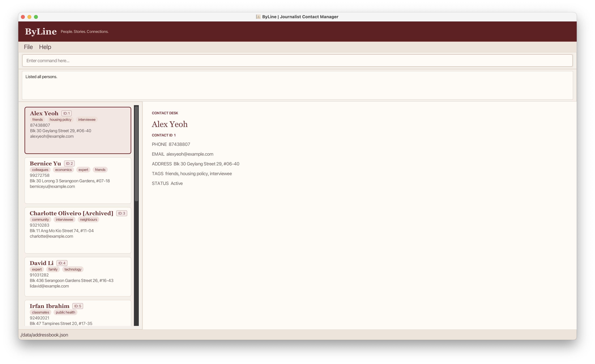
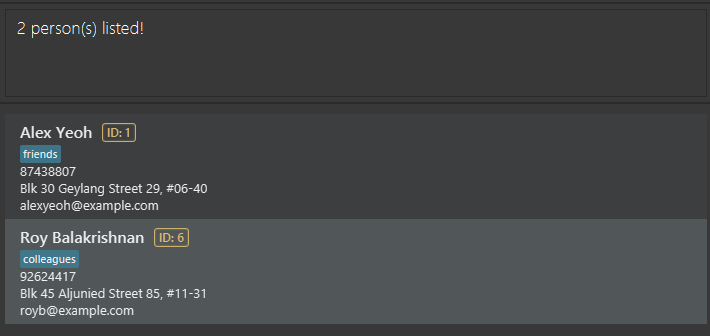
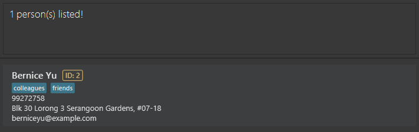
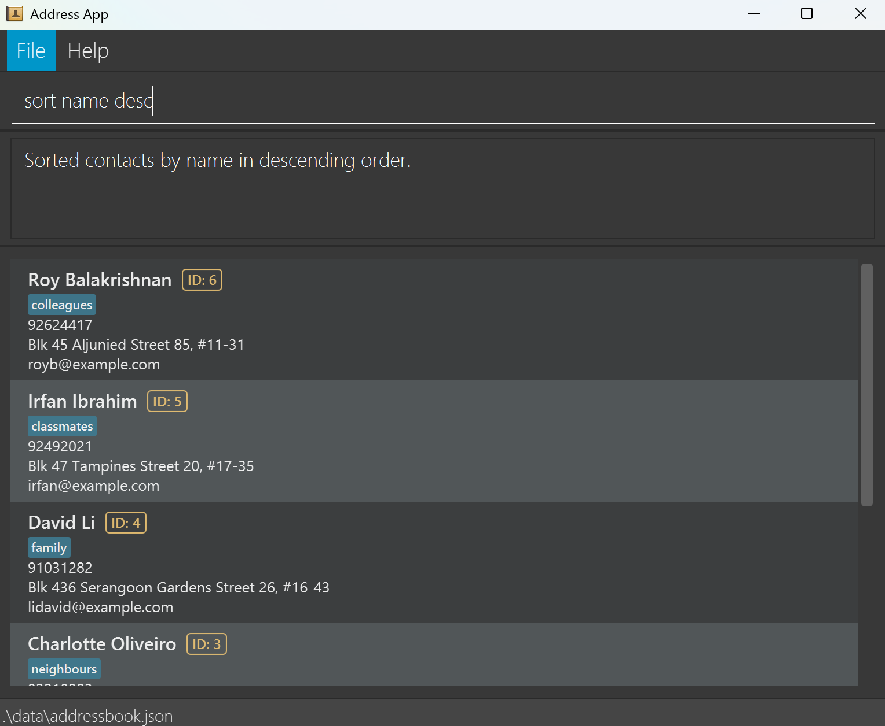
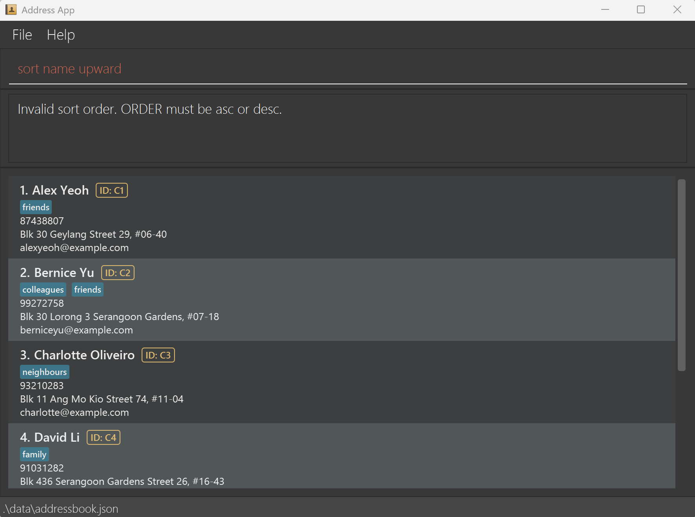

ByLine is a **desktop application for managing contacts, optimized for use through a Command Line Interface (CLI)** while retaining the benefits of a Graphical User Interface (GUI). If you type quickly, ByLine can help you manage contacts faster than traditional GUI applications.

* Table of Contents
{:toc}

--------------------------------------------------------------------------------------------------------------------

## Quick start

1. Ensure that Java `25` or later is installed on your computer. 
   **Mac users:** Ensure you have the precise JDK version prescribed [here](https://se-education.org/guides/tutorials/javaInstallationMac.html).

1. Download the latest `.jar` file from [here](https://github.com/AY2627S1-CS2103-F13-1/tp/releases).

1. Copy the file to the folder you want to use as the _home folder_ for your ByLine.

1. Open a terminal, `cd` to the folder containing the JAR file, and run `java -jar addressbook.jar`. 
   A GUI similar to the one below should appear in a few seconds. Note how the app contains some sample data. 
   

1. Type a command in the command box and press Enter to execute it. For example, type **`help`** and press Enter to open the help window. 
   Some example commands you can try:

   * `list` : Lists all active (not archived) contacts.

   * `add n/John Doe p/98765432 e/johnd@example.com a/John street, block 123, #01-01` : Adds a contact named `John Doe` to the Address Book.

   * `delete 3` : Deletes the contact with ID 3. Each contact's ID is shown as `ID: 3` on its card.

   * `clear` : Deletes all contacts.

   * `exit` : Exits the app.

1. Refer to the [Features](#features) section below for details of each command.

--------------------------------------------------------------------------------------------------------------------

## Features

**:information_source: Notes about the command format:** 

* Words in `UPPER_CASE` are the parameters to be supplied by the user. 
  For example, in `add n/NAME`, replace `NAME` with a value such as `John Doe`.

* Items in square brackets are optional. 
  For example, `n/NAME [t/TAG]` can be used as `n/John Doe t/friend` or as `n/John Doe`.

* Items followed by `…`​ can appear zero or more times. 
  For example, `[t/TAG]…​` may be omitted, or written as `t/friend` or `t/friend t/family`.

* Parameters can be in any order. 
  For example, if the command specifies `n/NAME p/PHONE_NUMBER`, `p/PHONE_NUMBER n/NAME` is also acceptable.

* Extraneous parameters for commands that take no parameters, such as `help`, `exit`, and `clear`, are ignored. 
  For example, `help 123` is interpreted as `help`. The exceptions are `undo` and `redo`, which show an error instead, so that `undo 3` is not mistaken for undoing three changes.

* If you are using a PDF version of this document, be careful when copying and pasting commands that span multiple lines as space characters surrounding line-breaks may be omitted when copied over to the application.

### Contact IDs

Every contact has an ID, a whole number shown as `ID: 3` on the contact's card. Commands that act on one contact, such as `edit` and `delete`, use this ID to pick the contact.

* A new contact gets the next unused ID. The first contact is `1`, the next is `2`, and so on.
* A contact keeps its ID for good. The ID does not change when you use `find`, `filter`, `sort` or `list`, archive the contact, or restart ByLine.
* Commands find the contact by its ID even if it is not in the list currently shown, e.g. after a `find`.
* IDs are never reused. After you delete a contact or run `clear`, the next new contact still gets a new ID. The one exception is [undoing](#undoing-a-change-undo) an `add`, which frees that contact's ID for the next contact you add.
* Type the ID as a plain number, e.g. `delete 3`.
* IDs go up to 999999. Because IDs are never reused, no more contacts can be added once ID 999999 has been given out.

### Viewing help: `help`

Shows a message explaining how to access the help page.

Format: `help`

### Adding a person: `add`

Adds a person to the address book.

Format: `add n/NAME p/PHONE_NUMBER e/EMAIL a/ADDRESS [t/TAG]…​`

* The new contact gets the next unused ID, shown in the result message and on its card. See [Contact IDs](#contact-ids).
* If every ID up to 999999 has been used, ByLine shows `Cannot add more contacts: every contact ID up to 999999 has already been used.`
* After the contact is added, ByLine shows your active contacts, as `list` does, so the new contact is in view.

:bulb: **Tip:**
A person can have any number of tags, including zero. Tags can contain letters, numbers and spaces, and are saved in lowercase.

Examples:
* `add n/John Doe p/98765432 e/johnd@example.com a/John street, block 123, #01-01`
* `add n/Betsy Crowe t/friend e/betsycrowe@example.com a/Newgate Prison p/1234567 t/criminal`

### Listing contacts: `list`

Shows contacts in the address book.

Formats:

* `list` shows only active contacts, i.e. contacts that are not archived. ByLine also shows these when it starts.
* `list all` shows all contacts, including archived ones.
* `list archive` shows only archived contacts.
* `all` and `archive` can be typed in upper or lower case, e.g. `list ARCHIVE`.
* Any other input, such as `list archived`, shows an error listing the accepted formats, and the displayed list stays the same.

### Editing a person: `edit`

Edits an existing person in the address book.

Format: `edit ID [n/NAME] [p/PHONE] [e/EMAIL] [a/ADDRESS] [t/TAG]…​`

* Edits the contact with the given `ID`, shown as `ID: 3` on the contact's card. See [Contact IDs](#contact-ids).
* If no contact has that ID, ByLine shows `No contact has the ID 3.` and nothing is changed.
* At least one of the optional fields must be provided.
* Existing values will be updated to the input values.
* When editing tags, all of the person's existing tags are removed; adding tags is not cumulative.
* To remove all of a person's tags, enter `t/` without a tag after it.
* To add or remove only some tags, use [`tag`](#adding-tags-to-a-contact-tag) or [`untag`](#removing-tags-from-a-contact-untag) instead.
* After the edit, ByLine shows the group the contact is in: your active contacts, or your archived contacts if the edited contact is archived. The edited contact stays in view.

Examples:
*  `edit 1 p/91234567 e/johndoe@example.com` Edits the phone number and email address of the contact with ID 1 to be `91234567` and `johndoe@example.com` respectively.
*  `edit 2 n/Betsy Crower t/` Edits the name of the contact with ID 2 to be `Betsy Crower` and clears all existing tags.

### Adding tags to a contact: `tag`

Adds one or more tags to a contact, keeping the tags it already has.

Format: `tag ID t/TAG [t/TAG]…​`

* Adds the given tags to the contact with the given `ID`. See [Contact IDs](#contact-ids).
* At least one tag must be given.
* A tag can contain letters, numbers and spaces, e.g. `housing policy`.
* Tags are saved in lowercase, so `t/Expert` is saved as `expert`. Tags that differ only in upper/lower case count as the same tag.

Examples:
* `tag 3 t/expert` adds the tag `expert` to the contact with ID 3.
* `tag 3 t/housing policy t/interviewee` adds the tags `housing policy` and `interviewee` to the contact with ID 3.

### Removing tags from a contact: `untag`

Removes one or more tags from a contact, keeping its other tags.

Format: `untag ID t/TAG [t/TAG]…​`

* Removes the given tags from the contact with the given `ID`. See [Contact IDs](#contact-ids).
* At least one tag must be given.
* Tags are matched ignoring upper/lower case, so `t/Expert` removes the tag `expert`.

Examples:
* `untag 3 t/expert` removes the tag `expert` from the contact with ID 3.
* `untag 3 t/housing policy t/interviewee` removes both tags from the contact with ID 3.

### Finding persons: `find`

Finds persons using part of their details. Combine one general substring with any selection of field-specific substrings, or use either kind of search on its own.

Format: `find [SUBSTRING] [n/NAME] [p/PHONE] [e/EMAIL] [a/ADDRESS] [t/TAG]…`

* Searches are case-insensitive: `al` matches both `Alex` and `Balakrishnan`.
* The general substring searches the name, phone number, email, address and tags. It must appear within at least one of these fields or one tag.
* Each prefixed substring searches only its corresponding field. A person must match the general substring, if supplied, and every field and tag condition.
* Search text is matched as one consecutive substring, including internal spaces. For example, `Alex Ye` matches `Alex Yeoh`, but `Ye Alex` does not.
* Put the general substring before the first prefix. Text after a prefix belongs to that prefix until the next recognised prefix or the end of the command. For example, `find example n/Alex` combines a general search for `example` with a name search for `Alex`; `find n/Alex example` searches the name for the single substring `Alex example`.
* Prefixes may appear in any order. If `n/`, `p/`, `e/` or `a/` is repeated, only its last value is used.
* For multiple `t/` prefixes, every tag substring must match at least one of the person's tags.
* `find` without search text or prefixes shows no persons.
* An empty value after `n/`, `p/`, `e/` or `a/` imposes no restriction on that field. An empty `t/` value matches any contact with at least one tag.
* Archived contacts are included in the results.

Examples:

* `find oak` finds persons with `oak` anywhere in their details, such as the name `Prof Oak` or the address `Oak Street`.
* `find n/Al` finds persons whose names contain `Al`.
  
* `find p/2345` finds persons whose phone numbers contain `2345`.
* `find n/Al e/example.com` finds persons whose names contain `Al` and whose email addresses contain `example.com`.
* `find example n/Al t/fri` finds persons with `example` in any searchable field, `Al` in their name and `fri` in at least one tag.
* `find t/fri t/col` finds persons whose tags match **both** substrings, such as someone tagged with both `friends` and `colleagues`. Persons tagged only with `friends` or only with `colleagues` are excluded. Adding field or tag conditions narrows the search instead of broadening it.
  

### Filtering contacts by tag: `filter`

Shows contacts that have every specified complete tag. Unlike `find`, which matches partial text, `filter` matches only whole stored tag values.

Format: `filter t/TAG [t/TAG]…​`

* At least one `t/TAG` must be given, and `t/` may be repeated in any order.
* A contact must contain **all** distinct specified tags. Additional tags on the contact do not prevent a match.
* Matching is case-insensitive. For example, `t/EXPERT` matches the stored tag `expert`.
* Repeated equivalent tags count as one condition, so `filter t/expert t/EXPERT` behaves like `filter t/expert`.
* Tags can contain letters, numbers and spaces. Leading and trailing spaces are ignored. Existing internal spaces are preserved, so exact matching also distinguishes different internal spacing. Punctuation and special characters are invalid.
* Matching uses complete tag values: `filter t/policy` does not match `housing policy` or `policy researcher`. Use `find t/policy` when partial tag matching is wanted.
* Each new `filter` examines all stored contacts and replaces any earlier `find` or `filter`; it does not narrow only the currently displayed list.
* Archived contacts are included when their tags match.
* `sort` after `filter` reorders only the matching contacts. A new `filter` clears a previous display-only sort, and `list` restores the complete contact list.
* Filtering is display-only: it does not add, edit, archive, restore, delete, or reorder stored contacts.

Valid examples:

* `filter t/housing` matches only the complete tag `housing`.
* `filter t/housing policy` matches contacts tagged `housing policy`.
* `filter t/housing policy t/expert` matches only contacts that have both tags.
* `filter t/interviewee t/singapore t/economics` requires all three tags.
* `filter t/Housing Policy t/EXPERT` demonstrates case-insensitive matching.

Invalid examples:

* `filter` and `filter t/` do not provide a valid tag.
* `filter housing t/expert` contains unsupported text before the first tag prefix.
* `filter n/Alex` uses an unsupported prefix.
* `filter t/housing-policy`, `filter t/housing_policy`, `filter t/@expert`, and `filter t/policy/research` contain invalid tag characters.
* `filter t/expert t/housing-policy` fails completely; ByLine does not filter using only the valid tag.

On success, including when no contacts match, ByLine shows `N person(s) listed!`, such as `2 person(s) listed!` or `0 person(s) listed!`.

For a command-structure error, ByLine shows:

`Invalid command format!` 
`filter: Filters contacts that have every specified tag.` 
`Parameters: t/TAG [t/TAG]...` 
`Example: filter t/housing policy t/expert`

For an invalid tag, ByLine shows `Tag names should contain only letters, numbers and spaces`. Invalid commands leave the displayed contacts and their ordering unchanged.

### Sorting displayed contacts: `sort`

Arranges the currently displayed contacts by a selected contact field. Sorting changes only the displayed order; it does not change contact details or the order stored in the address book.

Format: `sort FIELD [ORDER]`

* `FIELD` is mandatory. Supported fields are `name`, `phone`, `email`, `address`, and `tag`.
* `ORDER` is optional. Supported orders are `asc` and `desc`; omitting `ORDER` uses `asc`.
* `FIELD` and `ORDER` are case-insensitive. For example, `sort NAME DESC` is valid.
* Name, email, and address values are compared alphabetically without regard to letter case. The complete stored value is compared.
* Phone numbers are compared numerically. Leading zeroes do not affect their numeric value, so `000123` and `123` tie on phone number.
* For tag sorting, a contact's primary tag is the alphabetically first tag, ignoring letter case. Only that tag is used. Contacts without tags remain after tagged contacts in both ascending and descending order.
* Contacts that tie on the selected field are ordered by name in ascending order, regardless of the selected `ORDER`. If both the selected value and name tie, their existing relative order is preserved.
* Only the contacts currently displayed are sorted. A search or filter result remains the same subset, and the stored contact order remains unchanged.
* Running `list`, a new `find` or `filter`, `add` or `edit` replaces the sorted display. Run `sort` again to sort the new displayed list.
* Sorting an empty list or a list containing one contact succeeds even though its visible order does not change.

On success, ByLine shows the following message, substituting the selected field and the full order name:

`Sorted contacts by FIELD in ORDER order.`

For example, `sort name desc` shows `Sorted contacts by name in descending order.`

Invalid commands leave the displayed contact list unchanged and show one of these exact messages:

* Missing `FIELD` or extra arguments: 
  `Invalid command format!` 
  `Usage: sort FIELD [ORDER]`
* Unsupported `FIELD`: 
  `Invalid sort field. Valid fields are name, phone, email, address, and tag.`
* Unsupported `ORDER`: 
  `Invalid sort order. ORDER must be asc or desc.`

For example, an unsupported order leaves the displayed contact list unchanged:

Valid examples:

* `sort name` sorts names in ascending order.
* `sort phone asc` sorts phone numbers numerically in ascending order.
* `sort email desc` sorts complete email addresses in descending order.
* `sort tag` sorts by primary tag in ascending order and keeps untagged contacts last.
* `sort NAME DESC` sorts names in descending order because both parameters are case-insensitive.

Invalid examples:

* `sort` is missing the mandatory field.
* `sort date` uses an unsupported field.
* `sort name upward` uses an unsupported order.
* `sort name email` treats `email` as an invalid order.
* `sort name asc extra` contains an extra argument.

### Deleting a person: `delete`

Deletes the specified person from the address book.

Format: `delete ID`

* Deletes the contact with the given `ID`, shown as `ID: 3` on the contact's card. See [Contact IDs](#contact-ids).
* The contact is deleted even if it is not in the list currently shown.
* If no contact has that ID, ByLine shows `No contact has the ID 3.` and nothing is deleted.
* The deleted contact's ID is never given to another contact.

Examples:
* `delete 2` deletes the contact with ID 2.
* `find Betsy` shows the matching contacts with their IDs. If Betsy's card shows `ID: 5`, `delete 5` deletes that contact.

### Archiving a contact: `archive`

Archives a contact you are no longer working with, without deleting it.

Format: `archive ID`

* Archives the contact with the given `ID`. See [Contact IDs](#contact-ids).
* An archived contact keeps all its details and its ID. Its card shows `[Archived]` after the name.
* Archived contacts are hidden by `list` and when ByLine starts. Use `list archive` to see only archived contacts, or `list all` to see every contact. `find` still includes archived contacts in its results.
* If archived contacts are not being shown, e.g. after `list`, the contact disappears from the list once it is archived.
* An archived contact can still be edited, tagged or deleted.
* If the contact is already archived, ByLine shows `This person is already archived.`

Examples:
* `archive 4` archives the contact with ID 4.

### Restoring an archived contact: `restore`

Restores an archived contact, so that it is no longer archived.

Format: `restore ID`

* Restores the contact with the given `ID`. See [Contact IDs](#contact-ids).
* If the contact is not archived, ByLine shows `This person is not archived.`

Examples:
* `list archive` shows the archived contacts. If one of them shows `ID: 4`, `restore 4` restores it and it disappears from the archived list. Run `list` to see it among your active contacts.

### Clearing all entries: `clear`

Clears all entries from the address book.

Format: `clear`

IDs are not reset: the next contact you add still gets a new ID.

### Undoing a change: `undo`

Undoes the last change to your contacts.

Format: `undo`

* These commands can be undone: `add`, `edit`, `delete`, `clear`, `archive`, `restore`, `tag` and `untag`.
* Commands that only change what is shown, such as `list`, `find` and `sort`, are not undone. `undo` skips over them to the last change.
* You can undo up to 20 changes in a row. Older changes can no longer be undone.
* `undo` keeps the current view. For example, after a `find`, ByLine still shows only the contacts that match the search.
* The history of changes is cleared when you close ByLine, so changes made before a restart cannot be undone.
* If there is nothing to undo, ByLine shows `There is nothing to undo.`
* `undo` takes no parameters. Extra words, such as `undo 3`, show an error. Run `undo` again to undo more than one change.

:exclamation: **Caution:**
Undoing an `add` also takes back the contact's ID, so the next contact you add gets that same ID. This is the only case in which an ID is used again.

Examples:
* `delete 3` followed by `undo` brings back the contact with ID 3.
* `tag 2 t/expert`, then `tag 2 t/source`, then `undo` twice removes both tags.

### Redoing an undone change: `redo`

Redoes the last change you undid.

Format: `redo`

* You can redo each change you undid, in order, until you make a new change.
* After an `undo`, making a new change, e.g. with `add` or `edit`, means the undone changes can no longer be redone. Commands that only change what is shown, such as `list` or `find`, do not affect this.
* Redoing an undone `add` brings the contact back with the same ID.
* Like `undo`, `redo` keeps the current view, and its history is cleared when you close ByLine.
* If there is nothing to redo, ByLine shows `There is nothing to redo.`
* `redo` takes no parameters. Extra words, such as `redo 2`, show an error.

Examples:
* `delete 3`, then `undo`, then `redo` deletes the contact with ID 3 again.

### Exiting the program: `exit`

Exits the program.

Format: `exit`

### Exporting a backup: `export`

Saves **all contacts**, including archived contacts, their tags, IDs, and the next ID counter, to a JSON file.

Format: `export PATH` 
Example: `export C:/My Contacts/October backup`

* The destination folder must already exist. Existing files are not overwritten; choose a new filename for each backup.
* The `.json` extension is added automatically when omitted; explicit `.json` filenames also work. For example, `C:/My Contacts/October backup` refers to `C:/My Contacts/October backup.json`.
* Paths may contain spaces, with or without surrounding double quotes. Relative paths start from the application's working directory.
* Export does not depend on the current list or search filter. It backs up contact data, not application preferences.

### Loading a backup: `load`

Format: `load PATH` 
Example: `load C:/My Contacts/October backup`

As with `export`, `.json` is optional and spaces do not require quotes.

Loading replaces the **entire address book**, including archived contacts, with the backup's contacts and saved ID counter. Contacts absent from the backup are removed.

The app validates the requested file first. If the current address book contains user data, it automatically saves that data to a uniquely named JSON file in the same folder as the file passed to `load`, using a `before-load-` filename to avoid overwriting the source before replacing it. The success message shows the backup path, which you can use with `load PATH` to recover the previous contacts. Earlier backups are retained.

No automatic backup is created when the current address book is empty or exactly matches the unchanged starter sample data. Editing, tagging, or archiving a sample contact makes it non-default, so it will be backed up. The current list or search filter does not affect this decision.

Loading requires no confirmation. If validation or a required backup fails, loading stops without replacing current contacts. If saving the loaded data fails after the backup succeeds, the error message includes the backup path. These backups are created before loading, not after every command.

The source backup is not modified.

`restore ID` continues to unarchive one contact; use `load` to recover a backup. `export` creates a manual backup; `load` automatically backs up non-default current data before replacement.

### Saving the data

ByLine automatically saves data after every command. You do not need to save manually.

### Editing the data file

ByLine data is saved automatically as a JSON file `[JAR file location]/data/addressbook.json`. Advanced users are welcome to update data directly by editing that data file.

Each contact in the file has an `id`, and the file has a `nextPersonId`, which is the ID the next new contact will get. Do not change these. Changing them can make ByLine reuse old IDs, or make the data file invalid, for example if two contacts have the same ID or an ID is above 999999.

:exclamation: **Caution:**
If your changes make the data file invalid, ByLine starts with an empty address book at the next run. The invalid file remains on disk until you run a command (ByLine saves after every command). Still, we recommend backing up the file before editing it. 
Furthermore, certain edits can cause the ByLine to behave in unexpected ways (e.g., if a value entered is outside of the acceptable range). Therefore, edit the data file only if you are confident that you can update it correctly.

--------------------------------------------------------------------------------------------------------------------

## FAQ

**Q**: How do I transfer my data to another computer? 
**A**: Install the app on the other computer and overwrite the data file it creates with the data file from your previous ByLine home folder.

--------------------------------------------------------------------------------------------------------------------

## Known issues

1. **When using multiple screens**, if you move the application to a secondary screen, and later switch to using only the primary screen, the GUI will open off-screen. The remedy is to delete the `preferences.json` file created by the application before running the application again.
2. **If you minimize the Help Window** and then run the `help` command (or use the `Help` menu, or the keyboard shortcut `F1`) again, the original Help Window will remain minimized, and no new Help Window will appear. The remedy is to manually restore the minimized Help Window.

--------------------------------------------------------------------------------------------------------------------

## Command summary

Action | Format, Examples
--------|------------------
**Add** | `add n/NAME p/PHONE_NUMBER e/EMAIL a/ADDRESS [t/TAG]…​`   e.g., `add n/James Ho p/22224444 e/jamesho@example.com a/123, Clementi Rd, 1234665 t/friend t/colleague`
**Archive** | `archive ID`  e.g., `archive 4`
**Clear** | `clear`
**Delete** | `delete ID`  e.g., `delete 3`
**Edit** | `edit ID [n/NAME] [p/PHONE_NUMBER] [e/EMAIL] [a/ADDRESS] [t/TAG]…​`  e.g., `edit 2 n/James Lee e/jameslee@example.com`
**Find** | `find [SUBSTRING] [n/NAME] [p/PHONE] [e/EMAIL] [a/ADDRESS] [t/TAG]…`  e.g., `find oak`, `find n/Al t/fri` or `find example n/Al t/fri`
**Filter** | `filter t/TAG [t/TAG]…​`  e.g., `filter t/housing policy t/expert`
**List** | `list`, `list all` or `list archive`
**Help** | `help`
**Redo** | `redo`
**Restore** | `restore ID`  e.g., `restore 4`
**Sort** | `sort FIELD [ORDER]`  e.g., `sort name desc`
**Tag** | `tag ID t/TAG [t/TAG]…​`  e.g., `tag 3 t/expert t/housing policy`
**Undo** | `undo`
**Untag** | `untag ID t/TAG [t/TAG]…​`  e.g., `untag 3 t/expert`
